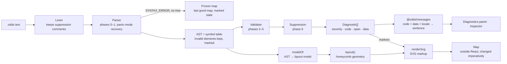
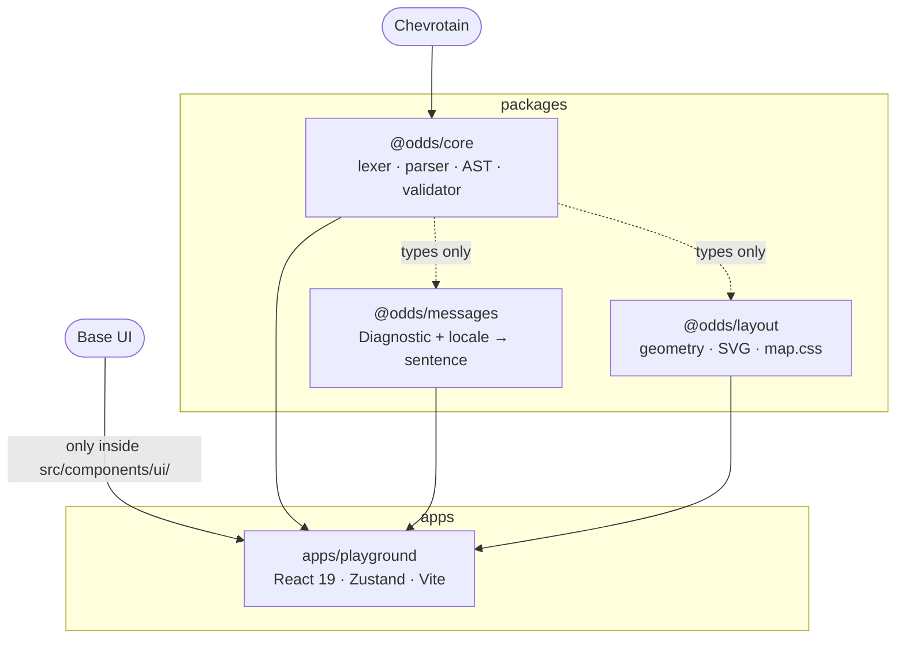
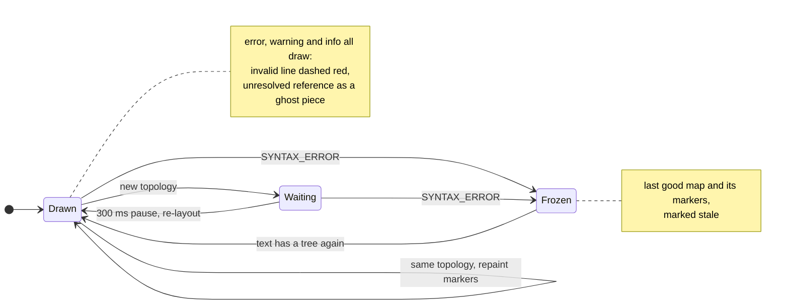
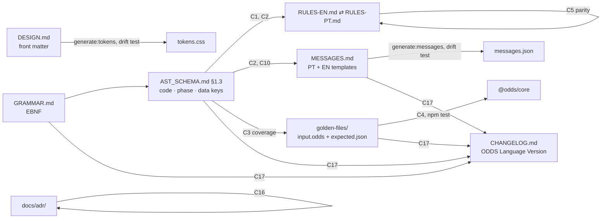

# Architecture

Five pictures of how ODDS is built, each answering one question. Terms follow [`GLOSSARY.md`](../GLOSSARY.md); the reasons behind each boundary are in [`docs/adr/`](adr/).

## 1. The project, as a Context Map

*How is ODDS itself organised, in its own terms?*

The project's strategic design is written in ODDS, in [`odds.odds`](odds.odds), and judged by its own linter on every `npm test` (`packages/core/test/selfMap.test.ts`). Each context is a package, or a third party one depends on.

| Subdomain | Type | Context | Package |
|---|---|---|---|
| Judgement | `core` | Validation | `@odds/core` |
| Language | `supporting` | Parsing | `@odds/core` |
| Visualization | `supporting` | Layout, Playground | `@odds/layout`, `apps/playground` |
| Localization | `generic` | Messages | `@odds/messages` |
| *external* | — | Chevrotain, Base UI | dependencies |

```odds
mapping {
  Parsing    [P]   <-> [P]       Validation
  Parsing    [CF]  <--           Chevrotain
  Layout     [ACL] <-- [OHS, PL] Parsing
  // odds-disable-next-line CORE_UPSTREAM_OF_GENERIC: ADR-0004, the linter publishes Diagnostic and knows no message text or locale
  Messages   [CF]  <-- [OHS, PL] Validation
  Playground       <-- [OHS, PL] Validation
  Playground       <-- [OHS]     Layout
  Playground       <-- [OHS]     Messages
  Playground [ACL] <--           BaseUi
}
```

Three of these lines are decisions, not just dependencies:

- **`Layout [ACL]`:** the layout never reads the AST directly. `modelOf` translates it into the layout's own model first.
- **`Playground [ACL] <-- BaseUi`:** Base UI is imported only inside `src/components/ui/` (ADR-0014), and the lint enforces it.
- **The one suppression:** the linter itself objects that the core is upstream of a generic subdomain. The project keeps it that way on purpose, so that the core never knows message text (ADR-0004), and the file records why.

## 2. What happens on every keystroke

*How does text become a judged, drawn map?*



`parseAndValidate` in `@odds/core` is the only surface the golden files touch (`TEST_SUITE.md` §3), and it covers everything from the lexer to the diagnostic array. A root error invalidates its element for the phases after it (`RULES-EN.md` §3.1). The element is still drawn, marked, but no later rule reasons about it.

## 3. Packages and their boundaries

*Where does a piece of code belong?*



| Package | Must not know about |
|---|---|
| `@odds/core` | Message text and locale. It does not depend on `@odds/messages`, and that missing import is the boundary (ADR-0004). |
| `@odds/messages` | Parsing |
| `@odds/layout` | The DOM, React and global state (ADR-0009) |

## 4. How the map degrades

*Why does the map never disappear?*



No severity blocks the map (`RULES-EN.md` §5). Only a pure `SYNTAX_ERROR` freezes it, because only then is there no tree to draw. While the layout waits for a new topology, the markers follow the text over the old geometry, so the pieces do not jump on every keystroke. The export is the map at rest, markers included.

## 5. The specification and what keeps it honest

*Which file do I change, and what checks it?*



A new rule always follows the same order: first `AST_SCHEMA.md` §1.3, then both `RULES` files, then `MESSAGES.md` in both languages, then a golden file (`.claude/rules/spec.md`). `npm run check:spec` runs the C-checks. C6 and C7 also keep removed constructs and dead vocabulary out of the normative documents. C17 runs before every commit, push and PR, so the language version cannot fall behind what a `.odds` file means.
